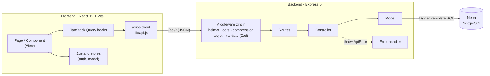

<div align="center">

# 🧱 Fullstack Boilerplate

**Modern, modüler ve üretime hazır bir Full-Stack MVC başlangıç şablonu**

Express 5 · Neon PostgreSQL · React 19 · Vite · MUI · Tailwind CSS v4 · Zustand · TanStack Query · Zod


</div>

---

## 📌 Bu proje nedir, ne işe yarar?

Her yeni projeye başlarken aynı işleri tekrar tekrar yapmak zorunda kalırız: klasör yapısını kurmak, Express'i güvenlik middleware'leriyle yapılandırmak, veritabanı bağlantısını kurmak, hata yönetimi yazmak, frontend'de tema, router, state yönetimi, API istemcisi, bildirim sistemi, form doğrulama…

**Fullstack Boilerplate**, bu tekrar eden altyapıyı bir kez ve doğru şekilde kurup, geliştiricinin doğrudan **iş mantığına (feature) odaklanmasını** sağlamak için hazırlandı.

Temel fikir şudur:

> **Her özellik (feature) bağımsız bir modüldür.** Backend'de bir klasör, frontend'de bir klasör.
> Klasörü eklediğinizde uygulama onu **otomatik olarak keşfeder** — hiçbir merkezi dosyayı düzenlemeniz gerekmez.

Ve bunu tek komuta indirger:

```bash
npm run generate task
```

Bu komut; veritabanı tablosu, model, controller, route'lar, doğrulama şeması, API istemcisi, React Query hook'ları, sayfa ve navbar linki dahil **çalışan bir full-stack CRUD modülü** oluşturur.

### Kimler için?

- Hızlıca **MVP / prototip** çıkarmak isteyen geliştiriciler
- Farklı projeleri **aynı mimari** üzerine inşa etmek isteyen ekipler
- Modern React + Node.js ekosistemini **iyi pratiklerle** öğrenmek isteyenler
- Portföy projelerine sağlam bir temel arayanlar

---

## ✨ Öne çıkan özellikler

| Alan                         | Özellik                                                                                                        |
| ---------------------------- | -------------------------------------------------------------------------------------------------------------- |
| 🏗️ **Mimari**                | npm workspaces monorepo · Backend'de modül tabanlı MVC · Frontend'de feature tabanlı yapı                      |
| 🔌 **Tak-çalıştır modüller** | `src/modules/*` (API) ve `src/features/*` (UI) otomatik keşfedilir ve bağlanır                                 |
| ⚡ **Kod üretici**           | `npm run generate <isim>` ile tek komutta full-stack CRUD modülü                                               |
| 🛡️ **Güvenlik**              | Helmet, CORS, Arcjet (Shield / bot tespiti / rate limit), Zod doğrulama, parametreli SQL                       |
| 🗄️ **Veritabanı**            | Neon serverless PostgreSQL · SQL injection'a karşı güvenli tagged-template sorgular · idempotent migration'lar |
| ❗ **Hata yönetimi**         | Merkezi error handler · `ApiError` sınıfı · Express 5 ile `try/catch`'siz async controller'lar                 |
| 🎨 **UI**                    | MUI 9 bileşenleri + Tailwind v4 yardımcı sınıfları (CSS Layers ile çakışmasız) · Açık/Koyu tema                |
| 🧠 **State**                 | İstemci state'i için **Zustand**, sunucu state'i (cache, refetch) için **TanStack Query**                      |
| 📝 **Formlar**               | React Hook Form + Zod (backend ile aynı doğrulama kütüphanesi)                                                 |
| 🚀 **Performans**            | Route bazlı lazy loading · Vendor chunk ayrıştırma · gzip sıkıştırma · uzun süreli asset cache                 |
| 🧰 **DX**                    | Tek komutla API + UI (`npm run dev`) · Vite proxy · ESLint 10 flat config · Prettier · `@/` alias              |

---

## 🧭 Mimari



### MVC katmanları

| Katman                | Nerede?                                     | Sorumluluk                                                                            |
| --------------------- | ------------------------------------------- | ------------------------------------------------------------------------------------- |
| **Model**             | `backend/src/modules/<x>/<x>.model.js`      | Veritabanıyla konuşan **tek** katman. SQL sorguları ve `migrate()` burada.            |
| **Controller**        | `backend/src/modules/<x>/<x>.controller.js` | HTTP isteğini model çağrısına, model sonucunu HTTP yanıtına çevirir. SQL içermez.     |
| **View**              | `frontend/src/features/<x>/`                | React arayüzü. API'yi `api/` ve `queries` katmanı üzerinden tüketir.                  |
| _Routes + Validation_ | `<x>.routes.js`, `<x>.validation.js`        | Endpoint tanımları ve Zod şemaları — controller'a sadece **doğrulanmış** veri ulaşır. |

### İstek yaşam döngüsü

```
Tarayıcı → Vite proxy (/api) → helmet → cors → compression → json parser → morgan
        → arcjet (shield / bot / rate-limit) → validate(Zod) → controller → model → Neon
        ← { success: true, data }   veya   ← errorHandler → { success: false, message, errors }
```

Tüm yanıtlar tutarlı bir zarf (envelope) kullanır:

```jsonc
// Başarılı
{ "success": true, "data": { ... }, "message": "Product created" }

// Doğrulama hatası (400)
{ "success": false, "message": "Validation failed",
  "errors": { "price": ["Price must be 0 or greater"] } }
```

---

## 📁 Klasör yapısı

```
Fullstack-Boilerplate/
├── package.json              # Workspace kökü: dev / build / start / generate komutları
├── .env.example              # Tüm ortam değişkenleri (backend + frontend tek dosyada)
├── scripts/
│   └── generate-module.js    # Full-stack modül üretici
│
├── backend/                  # @app/backend — Express 5 REST API
│   ├── package.json          # Sadece backend bağımlılıkları + "#alias" import'ları
│   └── src/
│       ├── server.js         # Başlatma: modülleri yükle → migrate → dinle → graceful shutdown
│       ├── app.js            # Express app (middleware, /api router, SPA servis)
│       ├── config/env.js     # .env yükleme + Zod ile doğrulama
│       ├── db/index.js       # Neon bağlantısı (sql``)
│       ├── lib/              # arcjet.js, logger.js
│       ├── middlewares/      # arcjet, validate (Zod), error + notFound
│       ├── utils/            # ApiError, response helpers (ok / created)
│       └── modules/
│           ├── index.js      # 🔍 Modül keşfi (auto-discovery)
│           └── product/      # Örnek modül
│               ├── index.js              # Manifest: { name, basePath, router, migrate }
│               ├── product.model.js      # M
│               ├── product.controller.js # C
│               ├── product.routes.js
│               └── product.validation.js
│
└── frontend/                 # @app/frontend — React 19 SPA
    ├── package.json          # Sadece frontend bağımlılıkları
    ├── vite.config.js        # Tailwind plugin, @ alias, /api proxy, chunk ayrıştırma
    ├── eslint.config.js
    └── src/
        ├── main.jsx
        ├── index.css         # Tailwind v4 + CSS layer sırası + tema token'ları
        ├── app/
        │   ├── providers.jsx # MUI tema, React Query, Snackbar, CSS layer
        │   ├── router.jsx    # Route ağacı (public / protected)
        │   └── features.js   # 🔍 Feature keşfi (import.meta.glob)
        ├── components/       # layout/ (Navbar, Footer), ui/ (ortak bileşenler), feedback/
        ├── features/
        │   ├── products/     # Örnek CRUD feature (api, components, pages, schema)
        │   └── auth/         # Login, ProtectedRoute, Profile
        ├── lib/              # api.js (axios), queryClient.js, notify.js
        ├── store/            # Zustand: useAuthStore, useModalStore
        ├── pages/            # HomePage, NotFoundPage
        ├── theme/            # MUI teması (light / dark)
        ├── utils/            # format.js, motion.js (animasyon varyantları)
        └── assets/           # İkonlar, görseller, Lottie animasyonları
```

---

## 🚀 Kurulum

### Gereksinimler

- **Node.js ≥ 20.19** (önerilen: güncel LTS)
- Bir **PostgreSQL** veritabanı — ücretsiz [Neon](https://neon.tech) hesabı yeterli
- _(Opsiyonel)_ Güvenlik katmanı için bir [Arcjet](https://arcjet.com) anahtarı

### Adımlar

```bash
# 1) Projeyi klonlayın
git clone https://github.com/<kullanici-adi>/Fullstack-Boilerplate.git
cd Fullstack-Boilerplate

# 2) Tüm bağımlılıkları kurun (workspaces sayesinde tek komut)
npm install

# 3) Ortam değişkenlerini hazırlayın
cp .env.example .env      # ardından .env dosyasını doldurun

# 4) Geliştirme ortamını başlatın (API + UI birlikte)
npm run dev
```

| Servis          | Adres                                                 |
| --------------- | ----------------------------------------------------- |
| Web arayüzü     | http://localhost:5173                                 |
| API             | http://localhost:3000/api (`PORT` değişkeninize göre) |
| Sağlık kontrolü | http://localhost:5173/api/health                      |

> İlk açılışta her modülün `migrate()` fonksiyonu çalışır ve gerekli tabloları **otomatik** oluşturur.

---

## 🔐 Ortam değişkenleri

Tüm değişkenler **kök dizindeki tek bir `.env`** dosyasında tutulur. Backend hepsini okur, frontend ise **yalnızca `VITE_` önekli** olanları görür. Böylece gizli anahtarlar tarayıcıya sızmaz.

| Değişken                                    | Zorunlu | Açıklama                                                                                                |
| ------------------------------------------- | ------- | ------------------------------------------------------------------------------------------------------- |
| `NODE_ENV`                                  | —       | `development` / `production` (varsayılan: `development`)                                                |
| `PORT`                                      | —       | API portu (varsayılan: `3000`)                                                                          |
| `CORS_ORIGIN`                               | —       | Production'da izin verilen origin'ler (virgülle ayrılır)                                                |
| `DATABASE_URL`                              | ✳️      | Tam PostgreSQL bağlantı adresi **veya** aşağıdaki 4 değişken                                            |
| `PGUSER` `PGPASSWORD` `PGHOST` `PGDATABASE` | ✳️      | `DATABASE_URL` boşsa bağlantı bunlardan oluşturulur                                                     |
| `ARCJET_KEY`                                | —       | Boş bırakılırsa Arcjet devre dışı kalır                                                                 |
| `ARCJET_ENV`                                | —       | Arcjet ortamı (`development` önerilir)                                                                  |
| `ARCJET_MODE`                               | —       | `LIVE` (engeller) / `DRY_RUN` (sadece loglar). Varsayılan: production'da `LIVE`, diğerlerinde `DRY_RUN` |
| `VITE_APP_NAME`                             | —       | Arayüzde ve sekme başlığında görünen uygulama adı                                                       |
| `VITE_API_URL`                              | —       | API farklı bir domain'deyse adresi. Boşsa aynı origin (`/api`) kullanılır                               |

> Değişkenler başlangıçta **Zod ile doğrulanır**. Hatalı bir değer varsa sunucu açık bir hata mesajıyla durur.
> Veritabanı tanımlı değilse API yine açılır; yalnızca veritabanı gerektiren endpoint'ler anlamlı bir hata döner.

---

## 🧩 Yeni modül / proje ekleme

### Yöntem 1 — Üretici ile (önerilen)

```bash
npm run generate task
npm run generate blog-post                 # çok kelimeli isimler desteklenir
npm run generate person -- --plural people # düzensiz çoğullar
npm run generate invoice -- --backend-only # sadece API
```

`npm run generate task` şunları üretir:

```
backend/src/modules/task/
  ├── index.js               → /api/tasks olarak otomatik bağlanır
  ├── task.model.js          → "tasks" tablosu + CRUD sorguları
  ├── task.validation.js     → Zod şeması
  ├── task.controller.js     → list / getById / create / update / remove
  └── task.routes.js         → GET, POST /   ·   GET, PUT, DELETE /:id

frontend/src/features/tasks/
  ├── index.js               → /tasks route'u + navbar linki (otomatik)
  ├── api/tasks.api.js       → REST istemcisi
  ├── api/tasks.queries.js   → useTasks, useCreateTask, useDeleteTask
  └── pages/TasksPage.jsx    → Liste + ekleme formu + silme
```

`npm run dev` açıksa backend otomatik yeniden başlar, tablo oluşturulur ve sayfa navbar'da belirir. Sonrasında yapmanız gereken tek şey **alanları kendi domain'inize göre düzenlemek** (model, validation ve sayfa).

### Yöntem 2 — Elle

**Backend:** `backend/src/modules/<isim>/index.js` dosyası şu manifesti export etmelidir:

```js
export default {
  name: "order",
  basePath: "/orders", // → /api/orders
  router, // express.Router()
  migrate: OrderModel.migrate, // opsiyonel, açılışta bir kez çalışır
};
```

**Frontend:** `frontend/src/features/<isim>/index.js` dosyası şu manifesti export etmelidir:

```js
import { ShoppingCart } from "lucide-react";

export default {
  name: "orders",
  order: 2, // navbar sıralaması (opsiyonel)
  routes: [
    { path: "orders", lazy: () => import("./pages/OrdersPage.jsx") },
    { path: "orders/:id", lazy: () => import("./pages/OrderDetailPage.jsx"), auth: true }, // korumalı
  ],
  nav: [{ label: "Orders", path: "/orders", icon: ShoppingCart }],
};
```

`auth: true` olan route'lar otomatik olarak `ProtectedRoute` altına yerleştirilir; giriş yapmamış kullanıcı `/login`'e yönlendirilir ve giriş sonrası kaldığı sayfaya döner.

> 💡 Bir modülü geçici olarak devre dışı bırakmak için klasör adının başına `_` koymanız yeterli (ör. `_legacy`).

---

## 🖥️ Frontend rehberi

### State yönetimi: Zustand + TanStack Query

Redux'un yerine iki küçük ve odaklı araç kullanılıyor:

- **Sunucu verisi** (ürünler, listeler…) → **TanStack Query**: cache, yeniden doğrulama, loading/error durumları, mutation sonrası otomatik yenileme.
- **İstemci state'i** (oturum, açık modal…) → **Zustand**: boilerplate'siz, Provider gerektirmeyen store'lar.

```jsx
// Sunucu state'i
const { data: products, isPending } = useProducts();
const createProduct = useCreateProduct(); // başarıda listeyi yeniler + toast gösterir

// İstemci state'i
const user = useAuthStore((s) => s.user);
const openModal = useModalStore((s) => s.openModal);
openModal("product-form", { product }); // düzenleme modalını aç
```

### Bildirimler

```js
import { notify } from "@/lib/notify";

notify.success("Kaydedildi!");
notify.error(error.message); // React dışından da çağrılabilir
```

### Onay diyaloğu

```js
openModal(CONFIRM_MODAL, {
  title: "Silinsin mi?",
  message: "Bu işlem geri alınamaz.",
  confirmText: "Sil",
  onConfirm: () => deleteProduct.mutateAsync(id),
});
```

### MUI + Tailwind birlikte

İki kütüphane **CSS Cascade Layers** ile çakışmadan çalışır. Katman sırası:

```css
@layer theme, base, mui, components, utilities;
```

Bu sayede Tailwind'in reset'i MUI'yi bozmaz ve `className` ile verilen Tailwind sınıfları MUI varsayılanlarını `!important` kullanmadan ezer:

```jsx
<Button variant="contained" className="rounded-full px-8">
  Kaydet
</Button>
```

Açık/koyu tema MUI tarafından yönetilir (`<html class="dark">`) ve Tailwind'in `dark:` varyantı aynı sınıfı dinler. Yani tek bir tema anahtarı her iki sistemi birlikte değiştirir.

### API istemcisi

`lib/api.js` içindeki axios örneği:

- `baseURL` olarak `/api` kullanır (geliştirmede Vite proxy'si üzerinden → CORS sorunu yok)
- Oturum token'ını `Authorization: Bearer …` başlığına otomatik ekler
- `{ success, data }` zarfını açar: `await api.get("/products")` doğrudan diziyi döner
- Hataları normalize eder: `error.message` her zaman okunabilir bir mesajdır, `error.errors` alan bazlı doğrulama hatalarını içerir
- `401` yanıtında oturumu otomatik kapatır

---

## 🛠️ Backend rehberi

### Hata fırlatma

Express 5, async fonksiyonlardaki hataları kendisi yakalar. `try/catch` yazmanıza gerek yok:

```js
export async function getById(req, res) {
  const product = await ProductModel.findById(req.validated.params.id);
  if (!product) throw ApiError.notFound("Product not found"); // → 404 JSON
  ok(res, product);
}
```

Production'da 5xx hatalarının detayı (stack trace) istemciye **gönderilmez**.

### Doğrulama

```js
router.put(
  "/:id",
  validate({ params: idParamSchema, body: productBodySchema }),
  controller.update, // req.validated.params.id → number, req.validated.body → temiz veri
);
```

### Güvenli SQL

```js
// ${...} ile verilen değerler parametre olarak gönderilir → SQL injection'a karşı güvenli
const [row] = await sql`SELECT * FROM products WHERE id = ${id}`;
```

### API uç noktaları (örnek modül)

| Metot    | Endpoint            | Açıklama                                 |
| -------- | ------------------- | ---------------------------------------- |
| `GET`    | `/api/health`       | API, veritabanı durumu ve yüklü modüller |
| `GET`    | `/api/products`     | Tüm ürünler                              |
| `GET`    | `/api/products/:id` | Tek ürün                                 |
| `POST`   | `/api/products`     | Ürün oluştur — `{ name, image, price }`  |
| `PUT`    | `/api/products/:id` | Ürün güncelle                            |
| `DELETE` | `/api/products/:id` | Ürün sil                                 |

---

## 📜 Komutlar

Tümü kök dizinden çalıştırılır:

| Komut                                 | Açıklama                                                             |
| ------------------------------------- | -------------------------------------------------------------------- |
| `npm run dev`                         | API (`node --watch`) ve Vite'ı birlikte başlatır                     |
| `npm run dev:api` / `npm run dev:web` | Yalnızca biri                                                        |
| `npm run build`                       | Frontend'i `frontend/dist` içine derler                              |
| `npm start`                           | API'yi başlatır. `NODE_ENV=production` ise derlenmiş SPA'yı da sunar |
| `npm run generate <isim>`             | Full-stack modül üretir                                              |
| `npm run lint`                        | ESLint                                                               |
| `npm run format` / `format:check`     | Prettier                                                             |

---

## 🌍 Production / Deploy

Uygulama **tek bir Node sürecinde** çalışacak şekilde tasarlandı: Express hem `/api`'yi hem de derlenmiş React uygulamasını sunar (SPA fallback dahil).

```bash
npm install
npm run build
NODE_ENV=production npm start
```

Render, Railway, Fly.io veya herhangi bir VPS'te:

- **Build command:** `npm install && npm run build`
- **Start command:** `npm start`
- **Env:** `NODE_ENV=production`, veritabanı bilgileri, `ARCJET_KEY`, `CORS_ORIGIN`

Production'da ayrıca:

- Arcjet varsayılan olarak `LIVE` modda çalışır (bot ve rate-limit engellemesi aktif)
- Asset'ler 1 yıllık cache ile, gzip sıkıştırmalı sunulur
- `trust proxy` açıktır, böylece reverse proxy arkasında doğru istemci IP'si kullanılır
- `SIGTERM` geldiğinde sunucu açık bağlantıları bitirip düzgünce kapanır

---

## 🧰 Teknoloji yığını

<table>
<tr><th>Backend</th><th>Frontend</th><th>Araçlar</th></tr>
<tr valign="top"><td>

- Node.js (ESM)
- Express 5
- Neon Serverless PostgreSQL
- Zod 4
- Arcjet
- Helmet · CORS · compression · morgan
- dotenv

</td><td>

- React 19
- Vite 8 (Rolldown)
- React Router 8
- MUI 9 + Emotion
- Tailwind CSS 4
- Zustand 5
- TanStack Query 5
- React Hook Form + Zod
- Motion · Lottie · Lucide · notistack

</td><td>

- npm workspaces
- concurrently
- ESLint 10 (flat config)
- Prettier
- EditorConfig

</td></tr>
</table>

### v1'den v2'ye neler değişti?

| Önce                                                             | Şimdi                                                | Neden                                                                           |
| ---------------------------------------------------------------- | ---------------------------------------------------- | ------------------------------------------------------------------------------- |
| Backend ve frontend bağımlılıkları kök `package.json`'da karışık | npm **workspaces**, her paketin kendi bağımlılıkları | Sürüm çakışmalarını önlemek (ör. `react-router-dom` v6 ↔ v7, `daisyui` v4 ↔ v5) |
| Redux Toolkit                                                    | **Zustand** + **TanStack Query**                     | Daha az boilerplate, sunucu verisi için gerçek cache                            |
| MUI + daisyUI + styled-components + Emotion                      | **MUI + Tailwind v4** (CSS layers)                   | Tek bileşen kütüphanesi, tek CSS-in-JS motoru                                   |
| react-hot-toast + notistack                                      | **notistack**                                        | Tek bildirim sistemi                                                            |
| @mui/icons-material + lucide-react                               | **lucide-react**                                     | Daha hafif, tree-shakable ikonlar                                               |
| Yup                                                              | **Zod** (frontend + backend)                         | Tek doğrulama dili                                                              |
| framer-motion                                                    | **motion**                                           | Paketin yeni adı                                                                |
| Express 4 + elle `try/catch`                                     | **Express 5** + merkezi error handler                | Async hatalar otomatik yakalanır                                                |
| Sabit route kaydı                                                | **Otomatik modül/feature keşfi** + üretici           | Yeni proje eklemek tek komut                                                    |
| nodemon                                                          | `node --watch`                                       | Ek bağımlılık yok                                                               |

---

## 🗺️ Yol haritası

- [ ] Gerçek kimlik doğrulama modülü (JWT / httpOnly cookie, bcrypt)
- [ ] Vitest + Supertest ile test altyapısı
- [ ] Dockerfile ve docker-compose (yerel PostgreSQL ile)
- [ ] GitHub Actions CI (lint + build + test)
- [ ] Sayfalama ve filtreleme yardımcıları
- [ ] OpenAPI / Swagger dokümantasyonu
- [ ] TypeScript sürümü

---

## 🤝 Katkı

1. Repoyu fork'layın
2. Yeni bir branch açın: `git checkout -b feature/harika-ozellik`
3. Değişikliklerinizi commit'leyin: `git commit -m "feat: harika özellik"`
4. Branch'i push'layın ve bir Pull Request açın

Commit mesajlarında [Conventional Commits](https://www.conventionalcommits.org/) kullanılması önerilir.

## 📄 Lisans

[MIT](./LICENSE) — dilediğiniz gibi kullanabilir, değiştirebilir ve dağıtabilirsiniz.
